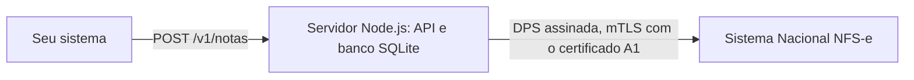

# Emissor de NFS-e Nacional

Emissor de NFS-e que fala direto com a API do Sistema Nacional NFS-e, sem intermediários e sem custo por nota. É um
servidor Node.js com banco SQLite, que roda em qualquer máquina ou container: o seu sistema envia os dados da venda e
recebe a nota autorizada, com o XML, o PDF e links prontos para mandar ao cliente.

Ele foi feito para empresas do Simples Nacional (ME, EPP e MEI) que prestam serviços no próprio município, e já emite
notas em produção para uma ME/EPP. Empresas fora do Simples ainda não são atendidas: veja
[para quem serve](#para-quem-serve).

## O que ele faz

- Emite a NFS-e e devolve o número, a chave de acesso e o XML autorizado.
- Nunca emite duas notas para a mesma venda: você escolhe o `id`, e repetir o pedido devolve a mesma nota.
- Se a resposta do governo se perder, ele confere se a nota foi emitida antes de enviar de novo.
- Cancela notas.
- Substitui uma nota emitida por outra corrigida; o governo cancela a antiga.
- Gera o PDF (DANFSe): usa o do governo quando o serviço dele responde; se não, gera um a partir do XML autorizado,
  com QR code para a consulta pública.
- Cria links assinados do PDF e do XML, que podem ir no e-mail do cliente.

Os testes validam os documentos contra os XSDs oficiais e conferem as assinaturas com o `xmlsec1`.

## Para quem serve

| Sua empresa | Funciona? | Em quais municípios |
|---|---|---|
| ME ou EPP do Simples Nacional | Sim. Já emite em produção. | Em todos os que têm o convênio ativo: 5.545 de 5.571, em 10/11/2026. |
| MEI | Sim, pelas regras oficiais. Ainda não foi testado em produção. | Em todos. |
| Fora do Simples (Lucro Presumido ou Lucro Real) | Ainda não. | — |

O emissor cobre o caso mais comum: serviço prestado no município da empresa, tributado pelo ISSQN e sem retenção. Veja
as [limitações](#limitações).

### Perguntas frequentes

**Funciona para MEI?** Sim, pelas regras oficiais. O MEI emite pelo Emissor Nacional desde 1º/9/2023, em qualquer
município, e a DPS que o emissor monta para ele segue essas regras. Dois avisos: pela API, o MEI precisa de um
certificado e-CNPJ A1, e esse caso ainda não foi testado em produção.

**É só para o Simples Nacional?** Hoje, sim: ME, EPP e MEI. Para empresas fora do Simples, a nota seria recusada,
porque esse regime informa os tributos aproximados em outro formato. Além disso, essas empresas já são obrigadas a
destacar o IBS e a CBS, o que o emissor não faz.

**Funciona no meu município?** Para ME/EPP do Simples, em todo município com o convênio ativo; em 10/11/2026, só 26
não estavam. Para MEI, em todos. Para confirmar, veja
[como conferir o seu município](docs/municipios.md#como-conferir-o-seu-município).

**A prefeitura tem sistema próprio de NFS-e. Funciona mesmo assim?** Sim, para MEI e para ME/EPP com o ISS apurado pelo
Simples. Desde 1º/11/2026, a Resolução CGSN nº 191/2026 obriga a ME e a EPP do Simples Nacional a emitir pelo Emissor
Nacional, e a prefeitura não autoriza mais essas notas no sistema dela. Como a regra é nova, este emissor ainda não foi
confirmado em produção num município assim.

**Quais serviços posso emitir?** Os tributados no município do prestador: 272 dos 337 códigos nacionais. Outros 31
funcionam quando o serviço é prestado no seu município. Obras, eventos e fornecimento de mão de obra não funcionam.

**E a reforma tributária (IBS e CBS)?** O emissor ainda não destaca o IBS e a CBS. Para os optantes pelo Simples
Nacional, a obrigatoriedade começa em 1º/1/2027, e o emissor precisa ser atualizado até lá.

A [documentação](docs/README.md) explica cada resposta, com as regras por município e as fontes oficiais.

## Quanto custa

| Item | Custo |
|---|---|
| Emissão | Nada: a API do governo é gratuita. |
| Servidor | O de qualquer máquina com Node.js, ou de um container. O emissor é leve: um servidor pequeno basta. |
| Certificado digital A1 (e-CNPJ) | Você compra de uma autoridade certificadora e renova todo ano. Se já emite notas, provavelmente já tem um. |

## Como funciona



- O **servidor** (`src/server.ts`) recebe as chamadas, guarda as notas num banco SQLite (`src/repo.ts`) e monta os
  documentos (`src/dps.ts`).
- Ele assina os documentos (XMLDSig, RSA-SHA256, em `src/sign.ts`) e fala com o governo usando o certificado
  (`src/gov.ts`). Os servidores do governo só pedem o certificado do cliente depois que a conexão já está aberta
  (renegociação TLS), o que o cliente HTTPS do Node faz.
- O número da DPS vem de um contador no banco e nunca se repete. Se um número já tiver sido usado fora daqui (no portal
  do governo, por exemplo), o emissor passa para o próximo.

## Antes de começar

Você vai precisar de:

1. **Empresa do Simples Nacional (ME, EPP ou MEI)**, num município com o convênio ativo no Sistema Nacional NFS-e. Para
   MEI, vale qualquer município. Veja [para quem serve](#para-quem-serve).
2. **Certificado A1 (e-CNPJ) do prestador**: o arquivo `.pfx` e a senha.
3. **Dados do seu contador**: a situação no Simples Nacional, a alíquota nominal da faixa do Simples (para ME/EPP), o
   código de tributação nacional do serviço e, se ele pedir, o código NBS.
4. **Um servidor** com **Node.js 24** (ou 22.18 em diante), o **pnpm** (rode `corepack enable`) e o `openssl`, ou
   então o **Docker**.

## Instalação

```sh
git clone https://github.com/gabrielbuzziv/emissor-nfse-nacional.git
cd emissor-nfse-nacional
pnpm install
cp .env.example .env
```

### 1. Configure os dados do emissor

Preencha o `.env`:

| Variável | O que é |
|---|---|
| `NFSE_ENVIRONMENT` | `restricted` (produção restrita, o ambiente de testes do governo) ou `production` (notas de verdade). Comece com `restricted`. |
| `ISSUER_CNPJ` | O CNPJ do prestador. |
| `ISSUER_CITY_CODE` | O código IBGE do município do CNPJ, com 7 dígitos ([consulte no IBGE](https://www.ibge.gov.br/explica/codigos-dos-municipios.php)). |
| `ISSUER_MUNICIPAL_SUBSCRIPTION` | A inscrição municipal. Deixe vazio, a menos que o município tenha cadastrado a empresa no Cadastro Nacional de Contribuintes (CNC). Com esse cadastro, ela é obrigatória (erro E0116); sem ele, a nota é recusada com o erro E0120. |
| `ISSUER_SIMPLES_OPTION` | A situação no Simples Nacional: `2` = MEI; `3` = ME/EPP. O valor `1` (não optante) é aceito, mas o emissor ainda não atende empresas fora do Simples. |
| `ISSUER_SIMPLES_APURATION` | Só para ME/EPP. `1` = tributos federais e municipal apurados pelo Simples Nacional, o caso mais comum. As outras opções estão no `.env.example`. |
| `ISSUER_SIMPLES_TOTAL_TAX_PERCENT` | Só para ME/EPP. A alíquota nominal da faixa do Simples em que a empresa está, que sai na nota como valor aproximado dos tributos (Lei 12.741/2012). Use ponto e 2 casas decimais, por exemplo `6.00`. |
| `DPS_SERIES` | A série das DPS, de 1 a 49999, a faixa que o governo reserva à API. O padrão é `1`. |
| `DATABASE_PATH` | O arquivo do banco SQLite. O padrão é `data/emissor-nfse.db`; a pasta é criada sozinha. |
| `PORT` | A porta da API. O padrão é `8080`. |
| `PUBLIC_URL` | O endereço público da API, por exemplo `https://nfse.seudominio.com.br`, quando ela fica atrás de um proxy com HTTPS. É o endereço que vai nos links das notas. |
| `ADMIN_PASSWORD` | O hash da senha do painel (`/admin`). Não escreva à mão: use `pnpm run admin-password` ([veja como](#criar-ou-trocar-a-senha)). Vazio desliga o painel. |

### 2. Adicione o certificado

```sh
pnpm run certificate caminho/do/certificado.pfx
```

O script pede a senha e confere se o certificado abre, se está na validade e se é do CNPJ configurado. Depois, grava o
certificado em base64 no `.env` (`CERT_PFX_B64`), com a senha (`CERT_PASSWORD`). Ele também aceita os arquivos `.pfx`
mais antigos (RC2/3DES), comuns em certificados A1.

Pode rodar de novo com o `.env` já existente, por exemplo para trocar o certificado: ele substitui `CERT_PFX_B64` e
`CERT_PASSWORD` e mantém as outras linhas. A senha é sempre pedida; a que já está no `.env` não é reaproveitada. Sem
terminal (num script, por exemplo), passe a senha na linha de comando:
`CERT_PASSWORD='senha' pnpm run certificate caminho/do/certificado.pfx`.

Se o `API_TOKEN` estiver vazio, o script também gera um. É o token que os seus sistemas usam para chamar a API. Guarde-o
num lugar seguro: ele protege a API e também assina os links públicos das notas. Trocar o token invalida os links já
enviados.

### 3. Inicie o servidor

```sh
pnpm start
```

Na primeira vez, o servidor cria o banco e as tabelas. Para manter o servidor no ar, use o gerenciador de serviços da
sua máquina (systemd, por exemplo) ou o Docker:

```sh
docker build -t emissor-nfse .
docker run -d --name emissor-nfse --restart unless-stopped --env-file .env -p 8080:8080 -v emissor-nfse-data:/data emissor-nfse
```

No Docker, o banco fica no volume `emissor-nfse-data`. Para ter HTTPS, coloque um proxy na frente (Caddy, nginx ou o
da sua hospedagem) e preencha `PUBLIC_URL`.

**Rode um único processo do servidor sobre o arquivo do banco.** A trava que impede duas requisições com o mesmo `id` de
emitir duas notas funciona dentro do processo; dois processos ou containers sobre o mesmo arquivo SQLite não são
suportados.

**Faça backup do arquivo do banco.** É nele que ficam as notas e o contador das DPS. O governo guarda as notas
emitidas, mas sem o banco o emissor perde a numeração e o vínculo entre o `id` de cada venda e a sua nota. Copie com o
próprio SQLite, que funciona com o servidor ligado (copiar só o arquivo `.db` pode perder as últimas gravações):

```sh
sqlite3 data/emissor-nfse.db ".backup backup-$(date +%F).db"
```

Uma cópia diária basta para poucas notas; para uma cópia contínua, use o [Litestream](https://litestream.io).

### 4. Confira a instalação

```sh
curl -H "Authorization: Bearer $API_TOKEN" "http://localhost:8080/health?deep=1"
```

Com tudo certo, a resposta traz `"ok": true`, a validade do certificado em `certificate.notAfter` e os parâmetros do
município em `cityAgreement`. Se faltar alguma variável, ela aparece em `config`.

O `"ok": true` diz que o governo aceitou o certificado e respondeu sobre o município. Para saber se a prefeitura usa os
emissores nacionais ou um sistema próprio, veja
[como conferir o seu município](docs/municipios.md#como-conferir-o-seu-município).

### 5. Teste e vá para a produção

Com `NFSE_ENVIRONMENT` em `restricted`, as notas vão para a produção restrita e não têm valor fiscal. Troque o
`serviceCode` pelo código do seu serviço:

```sh
curl -X POST "http://localhost:8080/v1/notas" \
  -H "Authorization: Bearer $API_TOKEN" \
  -H "content-type: application/json" \
  -d '{"id":"teste-1","serviceCode":"080201","description":"Nota de teste","valueCents":100}'
```

A produção restrita não tem todos os municípios. Se o seu não estiver lá (o `/health?deep=1` mostra), não dá para
testar a emissão antes da produção.

Para emitir notas de verdade:

1. Apague as notas de teste e zere a numeração. Os testes ficam no mesmo banco, e um `id` usado no teste devolveria a
   nota de teste. Faça isso só agora, nunca depois de ir para a produção:
   ```sh
   sqlite3 data/emissor-nfse.db "DELETE FROM notas; DELETE FROM counters;"
   ```
   Com o servidor parado. No Docker, apague o volume (`docker volume rm emissor-nfse-data`) antes de subir de novo.
2. Mude `NFSE_ENVIRONMENT` para `production` e reinicie o servidor.
3. Rode o `/health?deep=1` de novo.
4. Emita a primeira nota de uma venda real e confira os dados na consulta pública (o link `links.lookup` da resposta)
   antes de ligar a emissão automática.

## Vindo da versão na Cloudflare

As versões anteriores rodavam num Worker da Cloudflare, com o banco no D1. Para trazer as notas e a numeração:

1. Exporte o banco: `npx wrangler d1 export emissor-nfse --remote --output emissor-nfse.sql`.
2. Importe num banco novo, antes de iniciar o servidor:
   `mkdir -p data && sqlite3 data/emissor-nfse.db < emissor-nfse.sql`.
3. Copie os `vars` do `wrangler.jsonc` para o `.env`, rode `pnpm run certificate` e ponha no `API_TOKEN` o mesmo token
   de antes, para os links já enviados continuarem valendo.
4. Inicie o servidor. Ele reconhece o banco importado e não recria as tabelas.

## Painel administrativo

A página `/admin` é para uma pessoa só, que entra com uma senha. Os seus sistemas continuam usando o token da API,
como antes.

### Criar ou trocar a senha

```sh
pnpm run admin-password
```

O script pede a senha duas vezes, sem mostrá-la na tela, exige pelo menos 12 caracteres e grava no `.env` só um hash
scrypt em `ADMIN_PASSWORD`. Se o `.env` não existir, ele o cria a partir do `.env.example`. Sem terminal, passe a senha
pela entrada do script:

```sh
printf '%s\n%s\n' "$SENHA" "$SENHA" | pnpm run admin-password
```

Reinicie o servidor depois: é a reinicialização que liga o painel. Trocar a senha também encerra as sessões abertas,
quando o servidor reinicia.

No Docker, a imagem não traz a pasta `scripts/`. Rode o script na sua máquina, com o mesmo `.env`, e recrie o container
com `--env-file .env`.

### Entrar e sair

Abra `/login` (por exemplo, http://localhost:8080/login). A senha certa leva ao `/admin`. A sessão dura 12 horas a
partir do login, sem renovação. O botão "Sair" apaga a sessão deste navegador.

Uma senha errada mostra "Senha incorreta.", e as tentativas erradas seguidas do mesmo endereço esperam cada vez mais,
de 1 até 30 segundos.

### Atrás de um proxy

Com HTTPS (`PUBLIC_URL` em `https://` ou o cabeçalho `X-Forwarded-Proto`), o cookie sai com `Secure`.

O proxy precisa acrescentar o endereço do visitante ao `X-Forwarded-For`. O Caddy faz isso sozinho; no nginx, use
`proxy_set_header X-Forwarded-For $proxy_add_x_forwarded_for;`. Sem proxy, esse cabeçalho pode ser forjado, e a espera
entre as tentativas perde o efeito.

## API

Todas as rotas pedem o cabeçalho `Authorization: Bearer <API_TOKEN>`, menos os links públicos das notas. O painel chama
as mesmas rotas com o cookie da sessão, sem conhecer o token, e manda o cabeçalho `X-CSRF-Token` nas chamadas que não
são GET. Quando o cabeçalho `Authorization` está presente, só o token vale, como antes.

| Rota | O que faz |
|---|---|
| `POST /v1/notas` | Emite uma nota. Repetir o pedido com o mesmo `id` devolve a mesma nota. |
| `GET /v1/notas/:id` | Mostra a nota; com `?xml=1`, inclui o XML da NFS-e. |
| `GET /v1/notas/:id/pdf` | Devolve o PDF da nota (DANFSe). |
| `POST /v1/notas/:id/cancel` | Cancela a nota. |
| `GET /v1/notas` | Lista as notas, das mais recentes para as mais antigas. |
| `GET /health` | Confere a configuração e a validade do certificado; com `?deep=1`, também consulta o município no governo. |

### Emitir

```json
POST /v1/notas
{
  "id": "pedido-1001",
  "competence": "2026-11-10",
  "taker": { "taxId": "123.456.789-09", "name": "Maria Silva", "email": "maria@example.com" },
  "serviceCode": "080201",
  "nbsCode": "122051900",
  "description": "Curso online de fotografia",
  "valueCents": 9700
}
```

| Campo | O que é |
|---|---|
| `id` | Obrigatório. O identificador da venda no seu sistema, com até 200 caracteres. É ele que impede notas duplicadas. |
| `competence` | A data da prestação do serviço (`AAAA-MM-DD`), que não pode ser posterior à emissão. Se ficar de fora, vale a data de hoje em Brasília. |
| `taker` | O tomador: `taxId` (CPF ou CNPJ, com ou sem pontuação), `name` e, se quiser, `phone` e `email`. Para um tomador no exterior, troque `taxId` por `abroad` (veja [Exportação de serviço](#exportação-de-serviço)). Sem `taker`, a nota sai sem tomador identificado. |
| `serviceCode` | Obrigatório. O código de tributação nacional, com 6 dígitos (`080201` é o item 08.02.01). |
| `nbsCode` | O código NBS, com 9 dígitos. |
| `description` | Obrigatório. A descrição do serviço, com até 2.000 caracteres. |
| `valueCents` | Obrigatório. O valor do serviço em centavos (`9700` é R$ 97,00). |
| `export` | Só para exportação de serviço. Veja abaixo. |
| `replaces` | Só para substituir uma nota. Veja [Substituir](#substituir). |

A resposta é a nota, e o código HTTP diz o que aconteceu:

- **200**: emitida (`status: "issued"`). A nota traz `nfseNumber`, `accessKey` e `links`: o `pdf` e o `xml`, que são
  links públicos assinados, e o `lookup`, a consulta pública do governo.
- **422**: recusada (`status: "rejected"`), com os erros do governo em `errors`. Corrija o pedido e envie de novo com o
  mesmo `id`; o número da DPS é reaproveitado.
- **202**: o governo não respondeu (`status: "unknown"` ou `"pending"`). Envie o mesmo pedido mais tarde: antes de
  reenviar, o emissor confere se o governo chegou a emitir a nota.
- **400**: pedido inválido; o campo `error` diz o que corrigir.

### Exportação de serviço

Para um cliente no exterior, a nota sai como exportação de serviço, sem ISSQN (`tribISSQN` igual a `3`), com o país
onde o resultado do serviço acontece e o grupo de comércio exterior (`comExt`):

```json
POST /v1/notas
{
  "id": "invoice-2001",
  "taker": {
    "name": "Acme Inc.",
    "email": "billing@acme.example",
    "abroad": {
      "nif": "12-3456789",
      "address": { "country": "US", "postalCode": "94105", "city": "San Francisco", "region": "CA", "street": "Market St", "number": "1" }
    }
  },
  "serviceCode": "010101",
  "nbsCode": "115022000",
  "description": "Desenvolvimento de software sob encomenda",
  "valueCents": 1000000,
  "export": { "resultCountry": "US", "currency": "220", "foreignValueCents": 180000 }
}
```

| Campo | O que é |
|---|---|
| `taker.abroad.nif` | O número de identificação fiscal do tomador no país dele. |
| `taker.abroad.noNifReason` | No lugar do `nif`, quando o tomador não tem: `1` (dispensado) ou `2` (não exigido). |
| `taker.abroad.address` | Obrigatório com `nif`; sem NIF, pode ficar de fora. `country` (código ISO de 2 letras, nunca `BR`), `postalCode`, `city`, `region` (estado ou província), `street`, `number` e, se quiser, `complement` e `district` (bairro; se ficar de fora, vale a cidade). |
| `export.resultCountry` | Obrigatório. O país onde o resultado do serviço acontece, em código ISO de 2 letras. |
| `export.currency` | Obrigatório. O código da moeda na tabela do Banco Central: `220` dólar, `978` euro, `540` libra. |
| `export.foreignValueCents` | Obrigatório. O valor na moeda estrangeira, em centavos. |
| `export.mode` | Modo de prestação: `1` transfronteiriço (o padrão), `2` consumo no Brasil, `3` presença comercial no exterior, `4` movimento temporário de pessoas. |
| `export.relationship` | Vínculo com o tomador: `0` nenhum (o padrão), `1` controlada, `2` controladora, `3` coligada, `4` matriz, `5` filial, `6` outro. |
| `export.issuerSupport` | Mecanismo de apoio ao comércio exterior usado pelo prestador, de `01` (nenhum, o padrão) a `08`. |
| `export.takerSupport` | Mecanismo de apoio usado pelo tomador, de `01` (nenhum, o padrão) a `26`. |
| `export.shareWithMdic` | `true` para compartilhar a nota com a Secretaria de Comércio Exterior. O padrão é `false`. |

Na exportação, o `nbsCode` é obrigatório. Um tomador no exterior exige o `export`. Um tomador no Brasil pode ter
`export` quando o resultado do serviço acontece fora do país. As regras estão em
[Conformidade do emissor](docs/conformidade.md#exportação-de-serviço).

A isenção de PIS e Cofins da exportação não vai na nota. No Simples Nacional, a receita de exportação é separada na
apuração do PGDAS-D.

### Cancelar

```json
POST /v1/notas/pedido-1001/cancel
{ "reasonCode": "2", "reason": "Venda cancelada e valor devolvido ao cliente" }
```

O `reasonCode` pode ser `1` (erro na emissão), `2` (serviço não prestado, o padrão) ou `9` (outros). O `reason` é
opcional; o governo exige de 15 a 255 caracteres, e textos menores são completados com pontos.

- **200**: cancelada.
- **422**: o governo recusou, e o motivo está em `cancelErrors`. O prazo e as condições para cancelar
  [dependem do município](docs/regras-municipais.md#cancelamento); fora deles, o caminho é pedir a análise fiscal à
  prefeitura, o que este emissor não faz.
- **409**: a nota não está emitida. **404**: a nota não existe. **502**: o governo não respondeu; tente de novo.

### Substituir

Para corrigir uma nota já emitida, emita uma nova, com outro `id` e todos os campos já corrigidos, e diga em
`replaces` qual ela substitui. Quando a
nova é emitida, o governo cancela a antiga, e o emissor marca a antiga como `replaced`, com o `id` da nova em
`replacedBy`.

```json
POST /v1/notas
{
  "id": "invoice-2001-b",
  "taker": { "name": "Acme Inc.", "abroad": { "noNifReason": "2" } },
  "serviceCode": "010101",
  "nbsCode": "115022000",
  "description": "Desenvolvimento de software sob encomenda",
  "valueCents": 1000000,
  "export": { "resultCountry": "US", "currency": "220", "foreignValueCents": 180000 },
  "replaces": { "id": "invoice-2001", "reasonCode": "99", "reason": "Correção do valor em moeda estrangeira" }
}
```

| Campo | O que é |
|---|---|
| `replaces.id` | O `id` da nota a substituir, emitida por este emissor. Ela precisa estar emitida (`issued`). |
| `replaces.accessKey` | No lugar do `id`, a chave de acesso (50 dígitos) de uma nota emitida fora deste emissor, como no portal. |
| `replaces.reasonCode` | `01` desenquadramento do Simples Nacional, `02` enquadramento no Simples Nacional, `03` inclusão retroativa de imunidade ou isenção, `04` exclusão retroativa de imunidade ou isenção, `05` rejeição pelo tomador ou pelo intermediário, `99` outros (o padrão). |
| `replaces.reason` | O motivo, de 15 a 255 caracteres. Obrigatório com `99`. |

As respostas são as da emissão, e mais estas: **404** se a nota do `replaces.id` não existe e **409** se ela não está
emitida. O prazo e as condições para substituir
[dependem do município](docs/regras-municipais.md#substituição).

### Listar

`GET /v1/notas?status=issued&limit=50`: o `status` filtra (`pending`, `unknown`, `issued`, `rejected`, `canceled` ou
`replaced`), e
o `limit` vai até 100 (o padrão é 50). Para a página seguinte, passe em `before` o `createdAt` da última nota da página.

### Fluxo recomendado

1. Quando o pagamento for confirmado, chame `POST /v1/notas` com o identificador da venda.
2. **200**: guarde a nota e mande os `links` ao cliente.
3. **202**: tente de novo mais tarde, com o mesmo pedido. Um cron a cada poucos minutos resolve.
4. **422**: veja `errors`, corrija e envie de novo com o mesmo `id`.
5. Se a venda for estornada, chame `POST /v1/notas/:id/cancel`.

## Renovar o certificado

Antes do vencimento, rode `pnpm run certificate novo-certificado.pfx` e reinicie o servidor. No Docker, recrie o
container com o `.env` novo. Confira a validade em `GET /health` (`certificate.notAfter`).

## Problemas comuns

| Sintoma | O que fazer |
|---|---|
| O `/health` mostra `config` | Corrija as variáveis listadas no `.env` e reinicie o servidor. |
| `certificate.error` diz `no certificate` | Adicione o certificado com `pnpm run certificate` e reinicie o servidor. |
| `certificate.error` diz `cannot open the certificate` | A senha não abre o certificado; rode `pnpm run certificate` de novo. |
| `cityAgreement` sem status 200 | O município não está ativo nesse ambiente (a produção restrita não tem todos), ou o governo recusou o certificado. |
| Nota recusada com `HTTP 403` | O governo recusou o certificado: confira se ele é um e-CNPJ ICP-Brasil do prestador e se está na validade. |
| Nota recusada com `E0120` | Deixe `ISSUER_MUNICIPAL_SUBSCRIPTION` vazio. |
| Nota recusada com `E0116` | A prefeitura cadastrou a empresa no CNC: preencha `ISSUER_MUNICIPAL_SUBSCRIPTION`. |
| Nota recusada com `E0038` ou `E0039` | O convênio do município não está ativo, ou a prefeitura usa sistema próprio e o seu caso não é MEI nem ME/EPP com o ISS apurado pelo Simples. Veja [Municípios](docs/municipios.md). |
| Nota recusada com `E0312` | A prefeitura não tem esse código de serviço parametrizado na data de competência. Confira o `serviceCode`; se estiver certo, fale com a prefeitura. |
| Nota parada em `unknown` | O governo não respondeu. Envie o mesmo pedido mais tarde; se continuar assim, veja o `/health`. |
| `/login` responde 404 | O `ADMIN_PASSWORD` está vazio: rode `pnpm run admin-password` e reinicie o servidor. |
| O log mostra `ADMIN_PASSWORD is not a valid hash` | Rode `pnpm run admin-password` de novo e reinicie o servidor. |

As outras rejeições ligadas a município, regime e serviço estão em [Rejeições](docs/rejeicoes.md).

## Limitações

Este emissor cobre o caso mais comum de prestação de serviços:

- prestador ME, EPP ou MEI do Simples Nacional, identificado pelo CNPJ;
- serviço prestado no município do prestador, com ISSQN devido e não retido;
- sem regime especial de tributação, deduções, descontos ou tributos federais destacados na nota;
- sem o destaque do IBS e da CBS;
- tomador com CPF ou CNPJ, sem endereço, ou nota sem tomador;
- uma série de DPS e nenhuma substituição de nota.

Serviços de obra, de eventos e de fornecimento de mão de obra pedem dados que o emissor não envia. A lista completa
está em [Conformidade do emissor](docs/conformidade.md).

O governo muda o leiaute por meio de notas técnicas e costuma liberar as mudanças antes na produção restrita, que hoje
já usa o leiaute da NT 009. Quando a produção mudar, o `src/dps.ts` precisa acompanhar. Duas mudanças previstas atingem
o Simples Nacional: os campos novos da NT 009 e, em 1º/1/2027, o IBS e a CBS. Veja
[o que muda em 2027](docs/quem-pode-usar.md#o-que-muda-em-2027).

## Desenvolvimento

```sh
pnpm test            # documentos contra os XSDs oficiais, assinaturas e fluxos de emissão e cancelamento
pnpm run typecheck
pnpm run dev         # roda o servidor e reinicia a cada mudança no código
```

Os testes usam o `xmllint` e o `xmlsec1`. No macOS, rode `brew install libxmlsec1` (o `xmllint` já vem no sistema); no
Debian ou no Ubuntu, `sudo apt install libxml2-utils xmlsec1`.

O servidor roda o TypeScript direto no Node, sem etapa de build.

Contribuições são bem-vindas: abra uma issue ou um pull request, com `pnpm test` e `pnpm run typecheck` passando.

## Segurança

- Use o token da API só no servidor, nunca no navegador ou em apps.
- O certificado e a senha ficam no `.env`, que o script grava com permissão só para o dono do arquivo. O `.gitignore`
  bloqueia o `.env` e os arquivos `.pfx`, `.p12`, `.pem` e `.key`; nunca coloque esses arquivos no repositório.
- Os links públicos das notas são assinados com uma chave derivada do token.
- A senha do painel fica no `.env` só como hash scrypt com sal.
- A sessão do painel é um cookie `HttpOnly` e `SameSite=Strict`, com `Secure` em HTTPS, que vale 12 horas.
- Sair apaga o cookie deste navegador, mas uma cópia dele continua valendo até expirar.
- Quem lê o `.env` pode criar sessões do painel, como já pode usar o `API_TOKEN`; por isso o arquivo fica só com
  permissão do dono.

## Aviso

Este projeto não tem vínculo com a Receita Federal nem com o Sistema Nacional NFS-e e é distribuído sem garantia (veja a
[licença](LICENSE)). A responsabilidade pelas notas é de quem as emite: confirme a configuração fiscal com o seu
contador.

## Referências

- [Municípios, regimes e regras da NFS-e Nacional](docs/README.md): a documentação deste projeto
- [Portal da NFS-e](https://www.gov.br/nfse)
- [Documentação técnica](https://www.gov.br/nfse/pt-br/biblioteca/documentacao-tecnica)
- [Manual das APIs para contribuintes (PDF)](https://www.gov.br/nfse/pt-br/biblioteca/documentacao-tecnica/documentacao-atual/manual-contribuintes-apis-adn-sistema-nacional-nfse.pdf)
- [Produção restrita](https://www.gov.br/nfse/pt-br/biblioteca/documentacao-tecnica/producao-restrita)

## Licença

[MIT](LICENSE)
